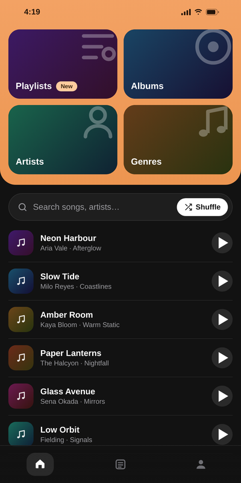
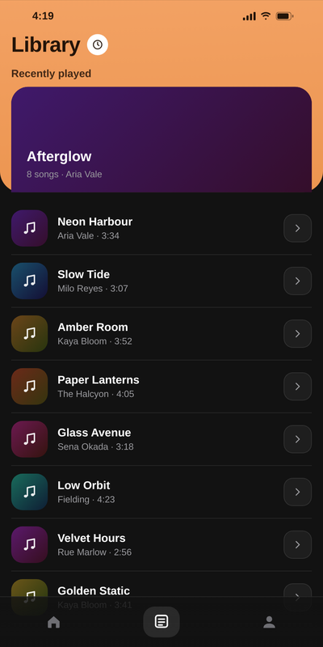
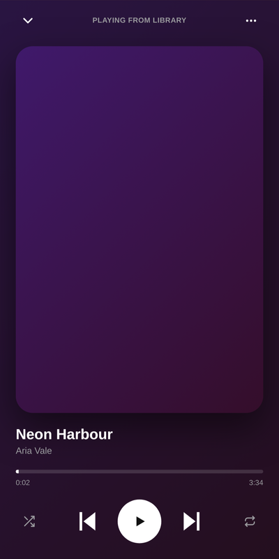
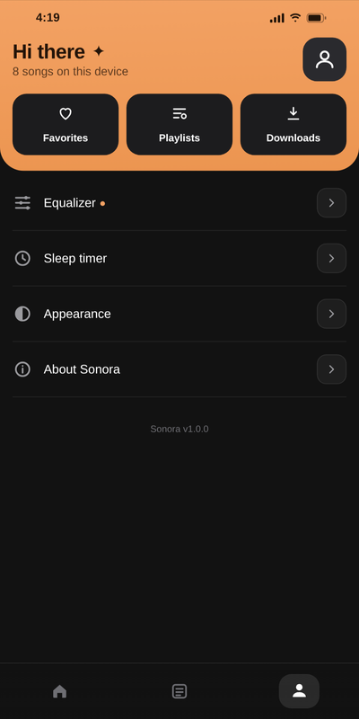

<div align="center">


# Sonora

**A warm, tactile local music player for Android — offline, private, and fast.**

[](https://github.com/itsrawdevvvvvv-arch/sonora/actions/workflows/build.yml)
[](https://github.com/itsrawdevvvvvv-arch/sonora/releases/latest)
[](https://github.com/itsrawdevvvvvv-arch/sonora/releases)
[](LICENSE)
[](#requirements)

<a href="https://github.com/itsrawdevvvvvv-arch/sonora/releases/latest">
  
</a>

</div>

---

Sonora is a small, good-looking music player for the songs already on your phone. It reads your device's audio library, plays it through a native player, and stays out of the way — no account, no ads, no tracking, and no network permission at all. Everything is on your device.

The interface is a single self-contained `index.html` (HTML, CSS and vanilla JavaScript) hosted in a WebView, so the whole app is one tiny, dependency-free APK.

<br>

<div align="center">
  
  
  
  
</div>

## Features

- **Your whole library** — every track on the device, listed and searchable by title, artist or album.
- **Warm, tactile design** — an amber hero, soft rounded tiles, a pill search bar and a sliding bottom nav.
- **Full playback** — play, pause, seek, next, previous, shuffle and three repeat modes (off / all / one).
- **Now-playing screen** — a full-bleed player with artwork, a draggable progress bar and transport controls.
- **Mini player** — a compact bar above the nav so the current track is always one tap away.
- **Instant search** — filter the library as you type.
- **Smooth by design** — every transition uses `transform` and `opacity` only, so it stays fluid on low-end phones.
- **Offline by design** — no account, no tracking, no network permission. Your music never leaves the device.
- **Small & fast** — one lightweight APK, no third-party runtime.

## Download

Grab the latest APK from the [**Releases**](https://github.com/itsrawdevvvvvv-arch/sonora/releases/latest) page.

| File | Description |
| --- | --- |
| `app-release.apk` | Release build — install this. |
| `app-release.apk.sha256` | SHA-256 checksum to verify your download. |

### Verify your download

```bash
sha256sum -c app-release.apk.sha256
```

## Install

Sonora is distributed as a direct APK (sideload), which is how most open-source Android apps ship outside of Google Play.

1. Download the APK from the Releases page.
2. Open it on your phone and allow "Install unknown apps" for your browser or file manager when prompted.
3. Install and open Sonora, then tap **Allow access** so it can read your music.

### Requirements

- Android 7.0 (API 24) or newer.
- A few MB of free storage.

## Building from source

### With Gradle (recommended)

```bash
git clone https://github.com/itsrawdevvvvvv-arch/sonora.git
cd sonora
./gradlew assembleRelease
```

The APK lands in `app/build/outputs/apk/release/`.

To produce a **signed** release, create a keystore and expose it to Gradle:

```bash
keytool -genkeypair -v -keystore sonora-release.jks -alias sonora \
  -keyalg RSA -keysize 2048 -validity 10950

export SONORA_KEYSTORE="$PWD/sonora-release.jks"
export SONORA_STORE_PASSWORD="your-store-password"
export SONORA_KEY_ALIAS="sonora"
export SONORA_KEY_PASSWORD="your-key-password"
./gradlew assembleRelease
```

See [`docs/BUILDING.md`](docs/BUILDING.md) for the full guide.

### Project layout

```
sonora/
├── app/
│   ├── build.gradle
│   └── src/main/
│       ├── AndroidManifest.xml
│       ├── java/com/sonora/app/MainActivity.java   # WebView host + audio bridge
│       ├── assets/
│       │   └── index.html                          # the entire app UI
│       └── res/                                    # icons, theme, strings
├── .github/workflows/                              # build + release CI
├── fastlane/                                       # store metadata + screenshots
├── screenshots/                                    # README images
└── docs/                                           # building, privacy
```

## How it works

Sonora's interface is a single self-contained `index.html` — HTML, CSS and vanilla JavaScript — served from the app's assets. A small `WebView` host (`MainActivity.java`) loads it and bridges the two things a WebView cannot do on its own:

- **Reading the library.** The native layer queries `MediaStore` for the device's audio (title, artist, album, duration, artwork) and hands the list to the page as JSON.
- **Playing audio.** A native `MediaPlayer` queue handles playback — play/pause, seek, next/previous, shuffle and repeat — and reports state back to the page, which draws the now-playing screen and mini player.

Because the UI runs in a WebView, all the visual work is plain CSS. Animations are restricted to `transform` and `opacity`, so they are GPU-composited and stay smooth even on modest hardware.

## Privacy

Sonora has **no network permission**. It cannot phone home even if it wanted to. It reads only your audio library, only on your device. See [`docs/PRIVACY.md`](docs/PRIVACY.md).

## Credits

Sonora is an independent, local music player. Its shell (a WebView-hosted `index.html` with a tiny Java bridge) follows the same pattern as its sibling project [**Notto**](https://github.com/itsrawdevvvvvv-arch/notto). It is not affiliated with any streaming service.

## License

[MIT](LICENSE) © Sonora contributors
